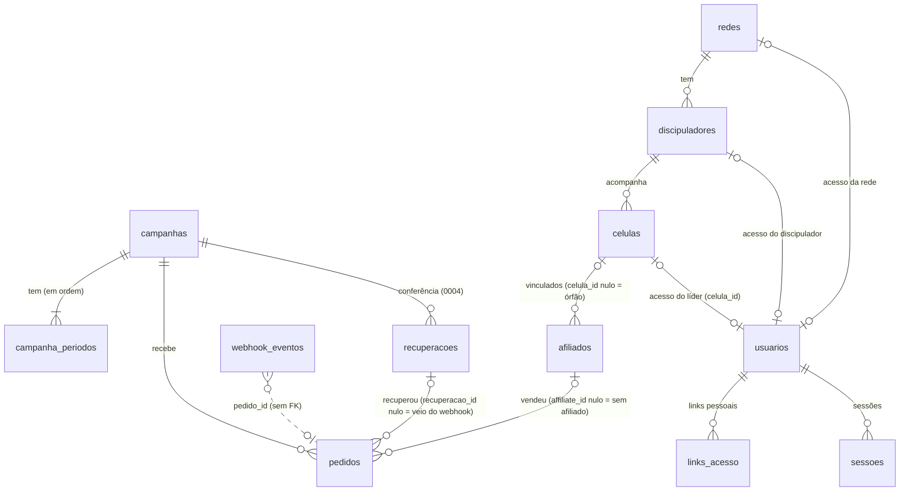

# Modelo de dados (Cloudflare D1)

- Migration: [`migrations/0001_init.sql`](../migrations/0001_init.sql), aplicada depois de `0000_setup.sql` (tabela `_meta`, RIFA-001). O acesso da equipe (`0002_acessos.sql`) e os papéis da hierarquia (`0006_acesso_hierarquia.sql`, RIFA-014) estão na seção [`usuarios`, `links_acesso` e `sessoes`](#usuarios-links_acesso-e-sessoes-acesso-da-equipe).
- Conferência pelo CSV da Rifei (RIFA-012): [`0004_conferencia.sql`](../migrations/0004_conferencia.sql), aditiva, com a tabela [`recuperacoes`](#recuperacoes-migração-0004-rifa-012) e as colunas `pedidos.origem` e `pedidos.recuperacao_id`. Não depende da 0005 à 0007 nem elas dela: aplicada antes ou depois delas, dá o mesmo schema (`src/worker/test/migracao-0004-depois.test.ts`).
- Tipos e schemas espelho: `src/shared/contracts/dominio.ts`.
- Teste do schema no workerd com o D1 local: `src/worker/test/migrations.test.ts` (tabelas e view criadas, CHECK de enum, FK, gravação de um pedido válido e atribuição pela view; a 0006, a 0007, a 0008, a 0009, a 0010 e a 0011 aplicadas sobre dados que já existiam; a 0004 aplicada depois da 0007, em `migracao-0004-depois.test.ts`).
- Índices só de leitura: `0003_vendas_por_dia.sql` (painel; recriado na 0008), `0007_indices_pedidos_entregas.sql` (lista de pedidos, entregas e estado do webhook, RIFA-025) e o da lista dos desconsiderados (0008), na [seção 4](#4-índices-e-consultas-típicas). Os planos das consultas que dependem deles são travados por teste com `EXPLAIN QUERY PLAN` e as linhas lidas (`src/worker/db/painel.test.ts`, `src/worker/db/pedidos-webhook-desempenho.test.ts`, `src/worker/db/mapa-ddd-desempenho.test.ts`, `src/worker/routes/painel-desempenho.test.ts`, `src/worker/routes/minha-desempenho.test.ts`, `src/worker/routes/reconciliacao-desempenho.test.ts` e `src/worker/db/links-vendas.test.ts`).
- Integração com a Rifei, com as decisões D1 a D9: [integracao-rifei.md](integracao-rifei.md).
- Regras do admin (Sprint 6, D20): [`0008_regras_campanha.sql`](../migrations/0008_regras_campanha.sql), aditiva, com as chaves e as mensagens em `campanhas`, a desconsideração em `pedidos`, o índice da 0003 recriado, o índice da lista dos desconsiderados e a view recriada. Como foi feita e por quê: [seção 9](#9-migração-0008_regras_campanhasql-rifa-028-029-e-032-d20).
- Token do webhook gerado pela tela (RIFA-039, D21): [`0009_token_webhook.sql`](../migrations/0009_token_webhook.sql), aditiva, com a tabela `token_webhook` (uma linha no máximo, só o SHA-256 do token). Aplicada depois da 0008; como foi feita, as consultas e o que foi medido: [seção 10](#10-migração-0009_token_webhooksql-rifa-039-d21).
- Link de vendas de cada célula (RIFA-046, D24): [`0010_link_vendas.sql`](../migrations/0010_link_vendas.sql), aditiva, com a coluna `campanhas.link_vendas_modelo` (o modelo do link de afiliado da Rifei, só do admin). Aplicada depois da 0009; as consultas e o que foi medido: [seção 11](#11-migração-0010_link_vendassql-rifa-046-d24).
- Pagamento registrado pela conferência (RIFA-056, D19): [`0011_pagamento_conferencia.sql`](../migrations/0011_pagamento_conferencia.sql), aditiva, com a coluna `pedidos.pagamento_recuperacao_id` e um índice parcial. Aplicada depois da 0010: [seção 12](#12-migração-0011_pagamento_conferenciasql-rifa-056-d19).

## 1. Visão geral



- **Hierarquia da igreja**: rede (divisão `jovens` ou `adultos`) → discipulador → célula (com `qtd_pessoas` e os dados do líder).
- **Rifei**: cada pedido chega pelo webhook e vira uma linha em `pedidos`, com o estado atual. Toda entrega também vira uma linha em `webhook_eventos`.
- **Ponte entre os dois lados**: `afiliados` liga o `affiliate_id` da Rifei a uma célula. A célula de uma venda é resolvida na **leitura** (view `vendas_aprovadas`), nunca gravada no pedido (D7).
- **Configuração**: `campanhas` e `campanha_periodos` guardam as regras da campanha (datas, preço, períodos e percentuais, regra de meta, critério do ranking, visão pública). Nada disso fica no código.

## 2. Convenções

- Nomes em português, snake_case. Os ids são `INTEGER PRIMARY KEY`, com duas exceções que vêm da Rifei: `pedidos.id` (texto) e `afiliados.affiliate_id` (inteiro).
- **Dinheiro em centavos** (`INTEGER`), conforme D2, convertido de forma exata a partir do decimal, com fração de centavo arredondada meio para cima ([integracao-rifei.md](integracao-rifei.md#6-valores-d2-e-fuso-d8)). **Percentuais em pontos-base** (3500 = 35%).
- Dinheiro, contadores e ids da Rifei têm `CHECK (typeof(x) = 'integer')`. A afinidade `INTEGER` do SQLite aceitaria `60.5` ou `'abc'` sem reclamar.
- **Instantes em UTC**, texto ISO 8601 com milissegundos e `Z` (`2026-12-01T12:20:31.512Z`). Com um formato único, a ordem alfabética é a cronológica, e o filtro por intervalo usa índice. O padrão das colunas `criado_em` e `atualizado_em` é `strftime('%Y-%m-%dT%H:%M:%fZ', 'now')`.
- **Datas locais** da campanha em `YYYY-MM-DD`, no fuso da campanha (D8).
- Os formatos de data e instante são checados com `date()` e `strftime()` (`CHECK (strftime('%Y-%m-%dT%H:%M:%fZ', x) IS x)`), e não com `GLOB`: o D1 recusa padrões GLOB/LIKE longos ("LIKE or GLOB pattern too complex"). A checagem também recusa datas impossíveis, como 30/02.
- O D1 sempre aplica chaves estrangeiras. As exclusões são `RESTRICT`, e a API responde `409 em_uso`. As exceções (`CASCADE`): `campanha_periodos`, que cai junto com a campanha; os links e as sessões, junto com o usuário (0002); e o usuário de um papel da hierarquia, junto com o alvo dele (0006).
- **D1/LGPD**: nenhuma coluna guarda nome, e-mail, documento, data de nascimento, endereço ou telefone completo do comprador. Os dados do **líder** de célula (nome, e-mail, telefone) são da equipe da igreja e fazem parte do cadastro da hierarquia.

## 3. Tabelas

### `campanhas`

Configuração da campanha. A API v1 trabalha sempre com a campanha **ativa**, e o índice parcial `campanhas_uma_ativa` garante no máximo uma.

| Coluna | Tipo | Regra |
|---|---|---|
| `id` | INTEGER PK | |
| `nome` | TEXT | 1–120 caracteres |
| `slug_rifei` | TEXT UNIQUE | slug da campanha na Rifei: só eventos com esse slug são processados (D5) |
| `ativa` | INTEGER 0/1 | padrão 1 |
| `fuso_horario` | TEXT | IANA; padrão `America/Belem` (D8) |
| `data_inicio` | TEXT | data local, primeiro dia de vendas |
| `preco_bilhete_centavos` | INTEGER > 0 | |
| `meta_unidade` | TEXT | `bilhetes` ou `centavos` |
| `meta_regra` | TEXT | `por_pessoa`, `total_proporcional` ou `fixa_por_celula` ([regras-de-calculo.md](regras-de-calculo.md), R1) |
| `meta_valor` | INTEGER > 0 | na unidade da meta; o significado depende da regra |
| `ranking_criterio` | TEXT | `percentual_meta`, `bilhetes` ou `arrecadacao` |
| `ranking_por_divisao` | INTEGER 0/1 | padrão 1 (migração 0012, D27): `ranking.por_divisao`. 1 = Jovens e Adultos com rankings separados; 0 = um ranking só, de todas as células |
| `publico_mostra_percentual_meta` | INTEGER 0/1 | padrão 0: o público vê só posições |
| `publico_limite_ranking` | INTEGER 1–100 ou NULL | padrão 3 (top 3); NULL mostra todas as posições |
| `pedidos_desconsiderar` | INTEGER 0/1 | padrão 0 (migração 0008, D20): a chave `pedidos.desconsiderar` |
| `acesso_discipuladores`, `acesso_redes` | INTEGER 0/1 | padrão 1 (0008): as chaves `acesso.discipuladores` e `acesso.redes` |
| `mensagem_link_coordenacao`, `mensagem_link_lider`, `mensagem_link_discipulador`, `mensagem_link_rede` | TEXT NULL, 1–1000 | o modelo de cada mensagem do WhatsApp (0008); NULL = o padrão do contrato (`MENSAGENS_PADRAO`), que a API devolve no lugar. Um modelo salvo igual ao padrão é gravado como NULL |
| `link_vendas_modelo` | TEXT NULL, 1–300 | o modelo do link de vendas (0010, D24): `https://rifei.com.br/...` com `{slug}` e `{afiliado}`, conferido pelo contrato (`problemasDoModeloLinkVendas`); NULL = o PO ainda não confirmou o formato com a Rifei, e nenhuma célula tem link. Só o admin muda (`PUT /api/admin/links-vendas/modelo`); o PUT da campanha nunca escreve nele |
| `criado_em`, `atualizado_em` | TEXT | instantes UTC |

O fim da campanha não é guardado: é `data_inicio + soma dos dias dos períodos − 1`.

### `campanha_periodos`

Períodos **consecutivos** a partir de `campanhas.data_inicio`, na `ordem` (ex.: 3 "semanas" de 10, 7 e 7 dias). Como cada período tem só a duração, não existe buraco nem sobreposição entre eles.

| Coluna | Tipo | Regra |
|---|---|---|
| `campanha_id` | INTEGER FK → campanhas (CASCADE) | PK (campanha_id, ordem) |
| `ordem` | INTEGER ≥ 1 | 1, 2, 3… |
| `nome` | TEXT | ex.: "Semana 1" |
| `dias` | INTEGER 1–366 | |
| `percentual_bp` | INTEGER 0–10000 | **a soma não precisa dar 10000**: o cálculo normaliza (seção 7.3) |

### `redes`, `discipuladores`, `celulas`

| Tabela | Colunas principais | Regras |
|---|---|---|
| `redes` | `nome`, `divisao`, `responsavel_nome` (pastor ou obreiro da rede, opcional) | `divisao` ∈ {`jovens`, `adultos`}; `nome` único |
| `discipuladores` | `rede_id` → redes, `nome` | `nome` único; índice por `rede_id` |
| `celulas` | `discipulador_id` → discipuladores, `nome`, `qtd_pessoas`, `lider_nome`, `lider_email`, `lider_telefone` | `nome` único; `qtd_pessoas` 1–1000 (é a base da meta); e-mail e telefone opcionais; índice por `discipulador_id` |

Os nomes são únicos com `COLLATE NOCASE`, que só ignora maiúsculas ASCII. A API compara nomes ignorando também maiúsculas acentuadas e os espaços nas pontas. Os nomes servem de chave na importação por CSV.

### `afiliados` (D7)

| Coluna | Tipo | Regra |
|---|---|---|
| `affiliate_id` | INT PK NOT NULL, > 0 | id do afiliado na Rifei. É `INT`, e não `INTEGER`, de propósito: assim não é alias do rowid, e um INSERT com NULL falha em vez de criar um afiliado fantasma |
| `celula_id` | INTEGER FK → celulas, NULL | NULL = **não vinculado** (fila de órfãos) |
| `rotulo` | TEXT NULL | nota da coordenação (ex.: usuário do líder na Rifei) |
| `origem` | TEXT | `webhook` (apareceu numa venda) ou `manual` (pré-cadastro) |
| `criado_em`, `atualizado_em` | TEXT | |
| `vinculado_em` | TEXT NULL | preenchido **se e somente se** `celula_id` não é NULL (CHECK) |

Uma célula pode ter mais de um afiliado, por exemplo se o líder tiver duas contas. As vendas de todos eles somam na célula.

### `pedidos`

Estado **atual** de cada pedido da Rifei. **Só `status = 'approved'` conta como venda.**

Os campos informativos (`status_rifei`, `status_detail_rifei`, `subtotal_centavos`, `metodo_pagamento`, `rifinha`, `criado_em`, `expira_em`) ficam NULL quando a Rifei manda o campo ausente ou com tipo errado: o webhook aceita a venda e registra o aviso em `webhook_eventos.avisos` (RIFA-002b). Os essenciais nunca ficam NULL: `id`, `campanha_id`, `status`, `qtd_bilhetes` e `total_centavos`.

| Coluna | Tipo | Origem no payload |
|---|---|---|
| `id` | TEXT PK NOT NULL (1–128) | `id`. O NOT NULL é explícito porque, no SQLite, uma PRIMARY KEY que não é INTEGER aceita NULL |
| `campanha_id` | INTEGER FK → campanhas | campanha ativa cujo `slug_rifei` = `slug` |
| `affiliate_id` | INTEGER FK → afiliados, NULL | `affiliate_id` (NULL = sem afiliado) |
| `status` | TEXT | `in_process`, `approved` ou `expired` (máquina D4) |
| `status_rifei`, `status_detail_rifei` | TEXT NULL | `status`, `status_detail` do último evento processado |
| `qtd_bilhetes` | INTEGER ≥ 0 | `numbers_count` |
| `numeros` | TEXT (JSON) NULL | `numbers`, usado na reconciliação |
| `subtotal_centavos` | INTEGER ≥ 0 NULL | `subtotal` (D2) |
| `total_centavos` | INTEGER ≥ 0 | `total` (D2): é o arrecadado; essencial, nunca NULL |
| `desconto_promocao_centavos`, `desconto_cupom_centavos` | INTEGER NULL | `promotion_discount`, `coupon_discount` |
| `cupom_id` | INTEGER NULL | `coupon_id` |
| `metodo_pagamento` | TEXT NULL | `payment_method` |
| `rifinha` | INTEGER 0/1 NULL | `is_rifinha` |
| `ddd` | TEXT NULL | derivado de `buyer.phone`; só para o Brasil (CHECK `ddd IS NULL OR pais = '55'`) |
| `pais` | TEXT NULL | código de discagem do país, derivado de `buyer.phone` (`55` = Brasil) |
| `utm_source` … `utm_term` | TEXT NULL | `utm.*` |
| `criado_em` | TEXT (UTC) NULL | `created_at`; NULL se vier ausente ou inválido |
| `expira_em` | TEXT (UTC) NULL | `expires_at` |
| `aprovado_em` | TEXT (UTC) NULL | `approved_at`; obrigatório quando `approved` (CHECK). Se a Rifei mandar null, vale o instante do recebimento |
| `expirado_em` | TEXT (UTC) NULL | `expired_at` |
| `registrado_em`, `atualizado_em` | TEXT (UTC) | nossos: primeira gravação e última alteração |
| `origem` | TEXT, padrão `webhook` | `webhook` ou `conferencia` (migração 0004). Os pedidos anteriores à 0004 ficaram com `webhook` |
| `recuperacao_id` | INTEGER FK → recuperacoes, NULL | a recuperação que gravou o pedido; preenchido **se e somente se** `origem = 'conferencia'` (CHECK) |
| `pagamento_recuperacao_id` | INTEGER FK → recuperacoes, NULL | migração 0011 (RIFA-056): a recuperação que marcou como pago o pedido do webhook que estava pendente ou expirado (o pagamento não registrado); só com `origem = 'webhook'` e `status = 'approved'` (CHECK). O webhook nunca escreve nela |
| `desconsiderado_em` | TEXT (UTC) NULL | migração 0008 (RIFA-028, D20): o admin tirou o pedido de todas as contas; NULL = o pedido conta |
| `desconsiderado_motivo` | TEXT NULL | `teste`, `fraude`, `estorno` ou `outro`; preenchido **se e somente se** `desconsiderado_em` (CHECK) |
| `desconsiderado_observacao` | TEXT NULL, 1–140 | só com `desconsiderado_em` (CHECK); nota do admin, sem dado pessoal (o contrato recusa "@" e 8 dígitos seguidos) |

**Desconsiderado** (RIFA-028, D20): sai de toda soma (painel, rankings, público, bumbo, `/minha`, mapa, adesão, totais do afiliado, totais da lista de pedidos e as somas da conferência), porque toda consulta que soma repete `desconsiderado_em IS NULL` (e o índice da 0003 e a view já não o têm); continua na lista de pedidos (com o selo e o filtro), na de suspeitos e na conferência, à parte. Quem desconsiderou fica na trilha (`auditoria`), não no pedido. O webhook nunca escreve nessas colunas: um evento que chega depois muda o status, mas o pedido continua desconsiderado.

Pedido recuperado na conferência (`POST /api/admin/reconciliacao/recuperar`, RIFA-012): entra `approved`, com `qtd_bilhetes`, `total_centavos`, `affiliate_id` e `aprovado_em` vindos do CSV da Rifei (lido no navegador); `numeros`, `ddd`, `pais`, `criado_em` e os campos informativos ficam NULL (os números dos bilhetes e o telefone não saem do navegador). Conta no painel, nos rankings e no bumbo como qualquer venda aprovada. Um evento do webhook que chegue depois segue a máquina da seção 5 (um `paid_order` dá `duplicado`).

Pagamento registrado na conferência (o mesmo `POST`, só o admin, RIFA-056): o pedido do webhook `in_process` ou `expired` que o CSV diz que está pago (e cuja quantidade, valor e afiliado o CSV confirma) vira `approved`, com `aprovado_em` do CSV, `atualizado_em` e `pagamento_recuperacao_id`; o resto do pedido (inclusive `origem = 'webhook'`) não muda. Conta como qualquer aprovado. Um `paid_order` que chegue depois dá `duplicado`.

### `webhook_eventos` (D3)

Uma linha por entrega **autenticada**, inclusive duplicadas e inválidas. Entregas com 401 ou 503 não são gravadas.

| Coluna | Tipo | Regra |
|---|---|---|
| `id` | INTEGER PK | devolvido como `evento_id` |
| `recebido_em` | TEXT (UTC) | |
| `evento`, `pedido_id`, `slug` | TEXT NULL | como vieram; em `erro_validacao`, só se forem texto |
| `resultado` | TEXT | `processado`, `duplicado`, `ignorado_outra_campanha`, `ignorado_transicao` ou `erro_validacao` |
| `status_anterior` | TEXT NULL | estado do pedido antes do evento (NULL se não existia) |
| `status_resultante` | TEXT NULL | preenchido em `processado`, `duplicado` e `ignorado_transicao` |
| `payload_redigido` | TEXT (JSON) NULL | `payloadRifeiRedigidoSchema`; NULL só em `erro_validacao` |
| `erro` | TEXT (JSON) NULL | lista de problemas, agrupados e limitados como os avisos, sem valores; preenchido **se e somente se** `erro_validacao` |
| `avisos` | TEXT (JSON) NULL | lista **não vazia** das diferenças do payload aceito em relação à doc (RIFA-002b): itens `{ caminho, codigo, mensagem, ocorrencias }`, agrupados por caminho sem índice, no máximo 50 mais um item final `itens_omitidos`, sem valores. CHECK: `json_type = 'array'` e pelo menos 1 item. NULL quando não há aviso (nunca `[]`); nunca em `erro_validacao` |

`pedido_id` não tem FK, porque eventos ignorados ou inválidos não geram pedido. Como o payload redigido fica guardado, dá para **reprocessar** eventos depois (por exemplo, os `ignorado_outra_campanha` recebidos antes de a campanha ser configurada).

### `recuperacoes` (migração 0004, RIFA-012)

Auditoria de cada "Recuperar" da conferência pelo CSV que gravou pelo menos um pedido (a gravação, num único `db.batch`, apaga a linha no mesmo lote se nada entrou). Código: `src/worker/db/reconciliacao.ts`; rotas em [api.md](api.md#conferência-pelo-csv-da-rifei-sprint-4-rifa-012).

| Coluna | Tipo | Regra |
|---|---|---|
| `id` | INTEGER PK | os pedidos gravados apontam para ele em `pedidos.recuperacao_id` |
| `campanha_id` | INTEGER FK → campanhas | campanha ativa no momento |
| `usuario_id` | INTEGER FK → usuarios (RESTRICT) | quem recuperou: admin ou coordenação, que não têm alvo na hierarquia e por isso nunca são apagados, só desativados |
| `executado_em` | TEXT (UTC) | |
| `pedidos_solicitados` | INTEGER ≥ 1 | códigos distintos pedidos pela coordenação |
| `pedidos_recuperados`, `bilhetes`, `total_centavos` | INTEGER ≥ 0 | contados dos pedidos que de fato entraram (os que já existiam ficam de fora) |
| `linhas_arquivo` | INTEGER ≥ 0 | linhas de dados do CSV |
| `arquivo_sha256` | TEXT (64 hex) | SHA-256 do texto do arquivo: identifica o arquivo usado sem guardar o conteúdo |
| `mapeamento` | TEXT (JSON objeto) | o **nome** da coluna do arquivo usada em cada campo (`{"pedido_id": "Pedido", "valor": null, ...}`); colunas de dado pessoal nunca podem ser usadas |

### View `vendas_aprovadas`

Pedidos `approved` que contam (sem os desconsiderados, desde a 0008) com a hierarquia resolvida por `LEFT JOIN`: afiliado → célula → discipulador → rede. As colunas são `pedido_id`, `campanha_id`, `affiliate_id`, `qtd_bilhetes`, `total_centavos`, `aprovado_em`, `ddd`, `pais`, `celula_id`, `discipulador_id`, `rede_id` e `divisao`.

- `celula_id` NULL = venda **sem célula** (sem afiliado ou afiliado não vinculado). Ela entra no total da campanha, mas não entra em nenhum ranking.
- Vincular um afiliado muda o resultado da view na hora, sem alterar `pedidos` (D7).

### `usuarios`, `links_acesso` e `sessoes` (acesso da equipe)

Migrations `0002_acessos.sql` (RIFA-007) e `0006_acesso_hierarquia.sql` (RIFA-014, D12). As regras do acesso (link, sessão, papéis, links em lote) estão em [acesso.md](acesso.md); aqui ficam as colunas e as restrições.

| Coluna de `usuarios` | Tipo | Regra |
|---|---|---|
| `id` | INTEGER PK | não é AUTOINCREMENT: o id de um usuário apagado (com o alvo) pode voltar num usuário novo (D12) |
| `nome` | TEXT | 1–120 caracteres; nos papéis da hierarquia, quem recebeu o último link do lote |
| `email` | TEXT NULL | |
| `ativo` | INTEGER 0/1 | 0 = os links não abrem sessão e as sessões foram apagadas |
| `criado_em` | TEXT | instante UTC |
| `celula_id` | INTEGER FK → celulas (CASCADE), NULL | o alvo do `lider` (0006) |
| `discipulador_id` | INTEGER FK → discipuladores (CASCADE), NULL | o alvo do `discipulador` (0006) |
| `rede_id` | INTEGER FK → redes (CASCADE), NULL | o alvo da `rede` (0006) |
| `papel` | TEXT | `admin`, `coordenacao`, `lider`, `discipulador` ou `rede`; o CHECK exige `(papel = 'lider') = (celula_id IS NOT NULL)`, e o mesmo para `discipulador` e `rede`: a coordenação sem alvo, cada papel da hierarquia com o seu e só ele. Nunca NULL (gatilhos, abaixo) |

- **Um usuário por alvo**: índices únicos parciais `usuarios_um_por_celula`, `usuarios_um_por_discipulador` e `usuarios_um_por_rede` (`WHERE <coluna> IS NOT NULL`). Também servem à cascata (achar o usuário do alvo apagado).
- **Papel obrigatório**: os gatilhos `usuarios_papel_obrigatorio_ao_inserir` e `usuarios_papel_obrigatorio_ao_atualizar` recusam papel NULL com a mesma mensagem do NOT NULL do SQLite (`NOT NULL constraint failed: usuarios.papel`). O `ALTER TABLE ADD COLUMN` não aceita NOT NULL sem um valor padrão, e um padrão daria um papel a quem não tem.
- **Cascata e auditoria**: apagar a célula, o discipulador ou a rede apaga o usuário do alvo e, com ele, os links e as sessões. A `auditoria` (0005) segura com `RESTRICT` o usuário que aparece como autor de uma ação: nesse caso o alvo não pode ser apagado (a API diz o motivo; acesso.md, seção 9). As `recuperacoes` (0004) também seguram o autor com `RESTRICT`, mas só admin e coordenação recuperam, e esses não têm alvo. A remoção que passa fica na trilha (`hierarquia.remover`, RIFA-018), com o id do usuário que caiu junto.
- **Como a 0006 foi feita, sem recriar a tabela**: recriar (o jeito de trocar um CHECK no SQLite) faria o DROP da tabela antiga apagar em cascata os links e as sessões e esbarraria no RESTRICT da auditoria (o `PRAGMA defer_foreign_keys` não segura ações de cascata). Por isso, coluna a coluna: (1) `celula_id`, `discipulador_id` e `rede_id` com `ADD COLUMN ... REFERENCES ... ON DELETE CASCADE`, sem CHECK; (2) `papel_novo` com o CHECK dos 5 papéis e da coerência com o alvo (nas linhas antigas ele começa NULL, e o CHECK com NULL não reprova); (3) `UPDATE` copiando o papel; (4) `DROP COLUMN papel`; (5) `RENAME COLUMN papel_novo TO papel` (o CHECK passa a citar `papel`); (6) os gatilhos, criados depois do DROP e do RENAME (um gatilho que cita a coluna barra o DROP COLUMN); (7) os índices únicos. A coluna `papel` ficou por último na tabela (as consultas sempre nomeiam as colunas). Uma troca futura de papel repete a técnica, com os dois gatilhos apagados antes do DROP e recriados depois.
- `src/worker/test/migrations.test.ts` aplica a 0006 num D1 à parte (`DB_MIGRACAO`, só dos testes) sobre usuários, links, sessões e auditoria gravados com as migrações anteriores e confere que tudo continua lá, além do CHECK, dos gatilhos, da cascata e da unicidade.

## 4. Índices e consultas típicas

| Índice | Serve para |
|---|---|
| `pedidos_por_status_aprovacao (status, aprovado_em)` | ritmo e ranking por janela de tempo: `status = 'approved' AND aprovado_em >= ? AND aprovado_em < ?` (validado com `EXPLAIN QUERY PLAN`, também através da view) |
| `pedidos_por_afiliado_status (affiliate_id, status)` | totais por afiliado (`GET /api/admin/afiliados`), "sem afiliado" (`affiliate_id IS NULL`) e a FK de `afiliados` |
| `pedidos_aprovados_por_afiliado_dia (campanha_id, affiliate_id, date(aprovado_em, '-180 minutes'), aprovado_em, qtd_bilhetes, total_centavos, desconsiderado_em) WHERE status = 'approved' AND desconsiderado_em IS NULL` (migração 0003, recriado na 0008) | painel, rankings, ranking público e bumbo (`src/worker/db/painel.ts`): vendas por afiliado e dia local de UTC−3 já na ordem do `GROUP BY`, sem a view, com 1 linha lida no D1 por pedido que conta (pela view eram ~6; o desconsiderado não está no índice). A consulta precisa usar a mesma expressão do dia, literal, e repetir `status = 'approved' AND desconsiderado_em IS NULL` (`db/painel.test.ts` confere o plano). Também serve às somas da conferência (`PAGOS_DA_CAMPANHA` em `db/reconciliacao.ts`, com o filtro repetido; `routes/reconciliacao-desempenho.test.ts`) |
| `pedidos_desconsiderados_por_registro (campanha_id, registrado_em, id) WHERE desconsiderado_em IS NOT NULL` (migração 0008, parcial) | a lista de pedidos com `desconsiderado=true` sem filtro de célula: lê só os desconsiderados, na ordem da lista (~2 linhas por desconsiderado). Com `desconsiderado=false`, o índice da 0007, com `+desconsiderado_em IS NULL` (o `+` tira o índice parcial da 0003 do planejador). Também a contagem dos desconsiderados nos totais do relatório (`CONTAR_DESCONSIDERADOS` em `db/relatorio.ts`, D23): `USING INDEX (campanha_id=?)`, sem a palavra COVERING (a coluna do filtro não está no índice), e ~1 linha lida no D1 por desconsiderado da campanha (`routes/relatorio-desempenho.test.ts`) |
| `afiliados_por_celula`, `celulas_por_discipulador`, `discipuladores_por_rede` | subir e descer a hierarquia, e as FKs |
| `pedidos_por_campanha_registro (campanha_id, registrado_em, id)` (migração 0007, RIFA-025) | lista de pedidos da coordenação (`GET /api/admin/pedidos`, `src/worker/db/lista-pedidos.ts`): os pedidos da campanha do registrado mais novo para o mais antigo, com o cursor `(registrado_em, id)`, saem na ordem do índice e a leitura para no limite (~133 linhas lidas na 1ª página com 7 mil pedidos; sem ele, ~26 mil). **Ele desvia o planejador** em consultas que pioram com ele, e elas fogem dele de propósito: totais com `+campanha_id` (senão ~2 linhas por pedido), lista e totais por célula com `afiliados CROSS JOIN pedidos` (senão percorre a campanha inteira), sem célula com `affiliate_id IS NULL OR affiliate_id IN (afiliados sem célula)` |
| `webhook_eventos_por_pedido`, `webhook_eventos_por_resultado (resultado, recebido_em)` | auditoria de um pedido; listar erros e ignorados recentes; no estado do webhook (`src/worker/db/estado-webhook.ts`), a contagem das últimas 24 h por resultado (com `resultado IN (...)`: sem ele, a contagem percorre o índice inteiro), os erros recentes e a última entrega de qualquer resultado por `MAX(recebido_em)` (com `ORDER BY ... LIMIT 1` o planejador ia para o índice da 0007 e lia ~34 mil linhas) |
| `webhook_eventos_por_resultado_id (resultado, id)` (migração 0007, RIFA-025) | entregas de um resultado da mais nova para a mais antiga, pelo id, com o cursor (`GET /api/admin/webhook/entregas`, `src/worker/db/entregas-webhook.ts`): ~51 linhas lidas por página, sem B-tree temporária (sem ele, ~800 a ~21 mil) |
| `webhook_eventos_da_campanha_por_slug (slug, recebido_em) WHERE resultado IN ('processado', 'duplicado', 'ignorado_transicao')` (migração 0007, parcial, RIFA-025) | a última entrega da campanha no estado do webhook (`MAX(recebido_em)` no slug da ativa, D16): 0 ou 1 linha lida. A consulta repete o MESMO `resultado IN (...)` do índice, senão o planejador não o usa. Pelo índice `(resultado, recebido_em)`, com o slug trocado depois de entregas processadas, o MAX percorria todas as entregas do slug antigo (~17,6 mil linhas por chamada) |
| `recuperacoes_por_campanha (campanha_id, executado_em)` e `pedidos_por_recuperacao (recuperacao_id) WHERE recuperacao_id IS NOT NULL` (migração 0004) | auditoria da conferência: as recuperações e os pedidos que cada uma gravou; a FK de `pedidos.recuperacao_id` |
| `pedidos_por_pagamento_recuperado (pagamento_recuperacao_id) WHERE pagamento_recuperacao_id IS NOT NULL` (migração 0011, RIFA-056) | os pagamentos registrados de cada recuperação (as contagens da gravação e o histórico); a FK de `pedidos.pagamento_recuperacao_id` |
| `campanhas_uma_ativa` (parcial, único) | garantir uma única campanha ativa |

Exemplo, ranking de células da campanha `?1` no período, com `[início, fim)` já convertido para UTC (`?2`, `?3`):

```sql
SELECT celula_id, count(*) AS pedidos, sum(qtd_bilhetes) AS bilhetes, sum(total_centavos) AS total_centavos
FROM vendas_aprovadas
WHERE campanha_id = ?1 AND aprovado_em >= ?2 AND aprovado_em < ?3 AND celula_id IS NOT NULL
GROUP BY celula_id;
```

## 5. Ciclo do pedido (D3, D4)

| Estado atual \ evento | `new_order` | `paid_order` | `expired_order` |
|---|---|---|---|
| (não existe) | processado → `in_process` | processado → `approved` | processado → `expired` |
| `in_process` | duplicado | processado → `approved` | processado → `expired` |
| `expired` | ignorado_transicao | processado → `approved` | duplicado |
| `approved` | ignorado_transicao | duplicado | ignorado_transicao |

- Pedido novo: recebe os dados do evento. Pedido existente: o `status` segue a máquina de estados, e os campos informativos (`affiliate_id`, `criado_em`, `expirado_em`, `utm_*`, cupom e descontos, `subtotal_centavos`, `status_rifei`, `status_detail_rifei`, `metodo_pagamento`) só são sobrescritos por valor **não nulo** (`COALESCE`). Um null de tolerância nunca apaga valor bom. `registrado_em` não muda.
- Afiliado tardio: pedido sem afiliado recebe o `affiliate_id` válido de **qualquer** evento dele, inclusive `duplicado` e `ignorado_transicao`.
- A gravação é idempotente: reentregar não duplica nada. Para continuar correta com entregas simultâneas, a transição usa UPSERT condicional (`ON CONFLICT (id) DO UPDATE ... WHERE pedidos.status IN (...)`), dentro de um `db.batch` junto com o afiliado e o evento.
- Fonte executável: `decidirTransicaoPedido` em `dominio.ts`.

## 6. Atribuição (D7)

1. Um `affiliate_id` desconhecido no webhook cria o afiliado com `celula_id = NULL` e `origem = 'webhook'`. É a fila de órfãos, listada em `GET /api/admin/afiliados?vinculado=false`.
2. A coordenação vincula com `PUT /api/admin/afiliados/:affiliateId { "celula_id": 7 }`, ou pré-cadastra o afiliado antes da primeira venda.
3. As vendas passam para a célula imediatamente, porque a view resolve a célula na leitura.
4. Venda sem `affiliate_id` fica em "sem afiliado".

## 7. Cálculos de metas, ritmo, ranking e bumbo

As regras de cálculo (metas e soma por nível, curva com normalização, meta do dia, situação, projeção, rankings, visão pública e bumbo) estão em [regras-de-calculo.md](regras-de-calculo.md), com fontes, exemplos e as suposições para o PO; o código é `src/shared/contracts/calculos.ts`. Nada disso é guardado no banco: as rotas leem a configuração, as células e as vendas aprovadas e calculam na hora. Aqui ficam só as convenções do modelo de dados que os cálculos usam.

### 7.1 Tempo

- `data_inicio` e os `dias` de `campanha_periodos` são do calendário local, sem fuso. Os períodos são consecutivos a partir de `data_inicio`, na `ordem`, e o último dia de vendas é `data_inicio` + soma dos dias − 1 (`calendario.ts`).
- `aprovado_em` é um instante UTC. O dia local `D` é `[D 00:00, D+1 00:00)` no fuso da campanha, convertido para UTC: em `America/Belem` (UTC−3 fixo), `[D 03:00Z, D+1 03:00Z)`, e o dia de uma venda é `date(aprovado_em, '-3 hours')`.

### 7.2 Entradas

- Meta: `meta_unidade`, `meta_regra` e `meta_valor` da campanha e `qtd_pessoas` de cada célula.
- Realizado: `qtd_bilhetes` (unidade `bilhetes`) ou `total_centavos` (unidade `centavos`) da view `vendas_aprovadas`, que só tem pedidos `approved`; `celula_id` NULL é venda sem célula.

### 7.3 Percentuais dos períodos

- `percentual_bp` guarda o valor configurado, que nunca é alterado: 3500, 2500 e 4500 continuam somando 10500. O cálculo normaliza na leitura, e `GET /api/admin/campanha` devolve `soma_percentuais_bp` para a interface avisar quando a soma é diferente de 10000. Pelo menos um percentual precisa ser maior que zero.

## 8. O que não é guardado (D1)

- Do comprador: nome, e-mail, documento (CPF), data de nascimento, endereço, telefone completo, `observation`, `fbp` e `fbc`. Ficam só `ddd` e `pais`.
- O payload bruto do webhook nunca é gravado, só o redigido.
- O CSV da conferência (RIFA-012), que traz dados pessoais, é lido no navegador e não vai para a API: ela recebe só as colunas mapeadas que não são pessoais. Do arquivo ficam só o SHA-256 e os nomes das colunas usadas (`recuperacoes`) e, do pedido recuperado, o que o pedido precisa (código, quantidade, valor, afiliado e instante).
- Segredos (como os tokens dos links e os ids das sessões, 0002): o token do webhook gerado pela tela (0009, D21) fica só como SHA-256 em `token_webhook`; nem ele nem o hash vão para a trilha (`auditoria`) ou para outra tabela (varredura em `src/worker/routes/webhook-token.test.ts`).

## 9. Migração `0008_regras_campanha.sql` (RIFA-028, 029 e 032; D20)

Aplicada na tarefa -db (RIFA-028-db) no MESMO merge que as consultas de `src/worker/db/` (item 3 do OBRIGATÓRIO da D20).
Aditiva para os dados: nenhuma linha muda; os pedidos de antes contam como hoje e a campanha fica com os padrões. O
plano foi provado num SQLite local (3.53) na revisão do contrato e de novo no D1 local do workerd, sobre dados das
migrações anteriores (`src/worker/test/migrations.test.ts`, "0008 sobre dados que já existiam"): os CHECK, a view, os
índices, os planos e a remoção do afiliado se comportaram como descrito abaixo.

**`campanhas`** (as chaves e as mensagens da D20):

| Coluna | Tipo | Regra |
|---|---|---|
| `pedidos_desconsiderar` | INTEGER 0/1 NOT NULL DEFAULT 0 | `pedidos.desconsiderar` |
| `acesso_discipuladores` | INTEGER 0/1 NOT NULL DEFAULT 1 | `acesso.discipuladores` |
| `acesso_redes` | INTEGER 0/1 NOT NULL DEFAULT 1 | `acesso.redes` |
| `mensagem_link_coordenacao`, `mensagem_link_lider`, `mensagem_link_discipulador`, `mensagem_link_rede` | TEXT NULL, 1–1000 caracteres | o modelo de cada mensagem; NULL = o padrão do contrato (`MENSAGENS_PADRAO`), que a API devolve no lugar |

Os marcadores do modelo são conferidos pelo contrato (o banco só confere o tamanho). No PUT, o grupo ausente mantém
as colunas dele (`COALESCE` com o valor gravado, ou o padrão no primeiro PUT); o grupo presente substitui o grupo
inteiro, e um modelo igual ao padrão do contrato é gravado como NULL (`src/worker/db/campanha.ts`).

**`pedidos`** (a desconsideração, RIFA-028; os três andam juntos):

| Coluna | Tipo | Regra |
|---|---|---|
| `desconsiderado_em` | TEXT (UTC) NULL | NULL = o pedido conta |
| `desconsiderado_motivo` | TEXT NULL | `teste`, `fraude`, `estorno` ou `outro`; preenchido **se e somente se** `desconsiderado_em` |
| `desconsiderado_observacao` | TEXT NULL, 1–140 | só com `desconsiderado_em`; sem dado pessoal (o contrato recusa "@" e 8 dígitos seguidos) |

Quem desconsiderou fica na trilha (`auditoria`), não no pedido. O webhook nunca escreve nessas colunas.

```sql
ALTER TABLE campanhas ADD COLUMN pedidos_desconsiderar INTEGER NOT NULL DEFAULT 0
  CHECK (pedidos_desconsiderar IN (0, 1));
ALTER TABLE campanhas ADD COLUMN acesso_discipuladores INTEGER NOT NULL DEFAULT 1
  CHECK (acesso_discipuladores IN (0, 1));
ALTER TABLE campanhas ADD COLUMN acesso_redes INTEGER NOT NULL DEFAULT 1
  CHECK (acesso_redes IN (0, 1));
ALTER TABLE campanhas ADD COLUMN mensagem_link_coordenacao TEXT
  CHECK (mensagem_link_coordenacao IS NULL OR length(mensagem_link_coordenacao) BETWEEN 1 AND 1000);
-- ... e o mesmo para mensagem_link_lider, mensagem_link_discipulador e mensagem_link_rede.

ALTER TABLE pedidos ADD COLUMN desconsiderado_em TEXT
  CHECK (desconsiderado_em IS NULL OR strftime('%Y-%m-%dT%H:%M:%fZ', desconsiderado_em) IS desconsiderado_em);
ALTER TABLE pedidos ADD COLUMN desconsiderado_motivo TEXT
  CHECK ((desconsiderado_motivo IS NULL) = (desconsiderado_em IS NULL)
    AND (desconsiderado_motivo IS NULL OR desconsiderado_motivo IN ('teste', 'fraude', 'estorno', 'outro')));
ALTER TABLE pedidos ADD COLUMN desconsiderado_observacao TEXT
  CHECK (desconsiderado_observacao IS NULL
    OR (desconsiderado_em IS NOT NULL AND length(desconsiderado_observacao) BETWEEN 1 AND 140));

-- O índice da 0003, recriado com o mesmo nome e a condição nova: o desconsiderado sai dele. A coluna
-- desconsiderado_em no fim (sempre NULL aqui) mantém o índice de cobertura: o SQLite deduz `status` do
-- `status = 'approved'` do WHERE do índice, mas não deduz do `IS NULL`; sem ela, cada pedido volta à tabela.
DROP INDEX pedidos_aprovados_por_afiliado_dia;
CREATE INDEX pedidos_aprovados_por_afiliado_dia ON pedidos (
  campanha_id, affiliate_id, date(aprovado_em, '-180 minutes'), aprovado_em, qtd_bilhetes, total_centavos,
  desconsiderado_em
) WHERE status = 'approved' AND desconsiderado_em IS NULL;

-- A lista com desconsiderado=true lê só os desconsiderados, na ordem da lista.
CREATE INDEX pedidos_desconsiderados_por_registro ON pedidos (campanha_id, registrado_em, id)
  WHERE desconsiderado_em IS NOT NULL;

-- A view da 0001, recriada com a condição nova (as mesmas colunas e junções).
DROP VIEW vendas_aprovadas;
CREATE VIEW vendas_aprovadas AS
SELECT
  p.id AS pedido_id, p.campanha_id AS campanha_id, p.affiliate_id AS affiliate_id, p.qtd_bilhetes AS qtd_bilhetes,
  p.total_centavos AS total_centavos, p.aprovado_em AS aprovado_em, p.ddd AS ddd, p.pais AS pais,
  a.celula_id AS celula_id, c.discipulador_id AS discipulador_id, d.rede_id AS rede_id, r.divisao AS divisao
FROM pedidos AS p
LEFT JOIN afiliados AS a ON a.affiliate_id = p.affiliate_id
LEFT JOIN celulas AS c ON c.id = a.celula_id
LEFT JOIN discipuladores AS d ON d.id = c.discipulador_id
LEFT JOIN redes AS r ON r.id = d.rede_id
WHERE p.status = 'approved' AND p.desconsiderado_em IS NULL;
```

- **O índice parcial só vale com a condição repetida.** Com `status = 'approved' AND desconsiderado_em IS NULL` na
  consulta do painel, o plano é `SEARCH pedidos USING COVERING INDEX pedidos_aprovados_por_afiliado_dia
  (campanha_id=?)`, sem B-tree temporária na agregação por afiliado e dia (o que `painel.test.ts` exige hoje). Sem
  o `desconsiderado_em IS NULL`, o planejador vai para `pedidos_por_campanha_registro` (0007) com `USE TEMP B-TREE
  FOR GROUP BY`: por isso a migração e as consultas entram juntas, e o `painel.test.ts` trava o plano.
- **A coluna `desconsiderado_em` no fim do índice** (revisão do contrato, provado no SQLite 3.53 e no D1 local do
  workerd): sem ela, o plano com o filtro sai `USING INDEX`, não `USING COVERING INDEX` (o SQLite volta à tabela
  para conferir o `IS NULL`), e a expressão de `painel.test.ts` falha. Vale também para as somas da conferência
  (`PAGOS_DA_CAMPANHA` em `db/reconciliacao.ts`), que hoje usam este índice de cobertura e, sem o filtro, iriam
  para o da 0007 (o agrupamento por afiliado ganha B-tree temporária).
- A lista com `desconsiderado = true` usa `pedidos_desconsiderados_por_registro`; com `false` ou sem o filtro, o
  índice da 0007, como hoje. Um índice novo pode desviar o planejador noutras consultas (D16): os testes de plano
  e de linhas lidas conferem.
- Ordem: as colunas antes do índice e da view, que as citam. A recriação da view não toca em dados.
- **Remover afiliado** (RIFA-031): `pedidos.affiliate_id` é `ON DELETE RESTRICT` (0001), então o afiliado só sai
  depois de `UPDATE pedidos SET affiliate_id = NULL` nos pedidos desconsiderados dele, no mesmo lote (provado: o
  DELETE direto é recusado pela FK; depois do UPDATE, passa).
- **O `+` tira o índice parcial do planejador**: `+desconsiderado_em IS NULL` não satisfaz o WHERE do índice
  (conferido no D1 local: com `INDEXED BY`, "no query solution"). O mapa (`db/mapa-ddd.ts`) e a lista com
  `desconsiderado=false` usam o `+` para ficar nos índices de hoje ((status, aprovado_em) e o da 0007), como os outros
  `+` de D16 e D17.
- Teste da migração (`src/worker/test/migrations.test.ts`): a 0008 aplicada sobre dados das anteriores (pedidos de
  todos os status, aprovados com e sem afiliado, e uma campanha) confere que tudo continua contando (a view e a
  consulta do painel somam o mesmo de antes), os padrões da campanha (também montada no contrato), os CHECK (motivo
  sem data, data sem motivo, observação sem desconsideração, vazia ou acima de 140, motivo fora da lista, data fora
  do formato, chave fora de 0/1, modelo vazio ou acima de 1.000), a view e o índice sem o desconsiderado (e de volta
  ao desfazer), as definições dos dois índices, o plano do painel e a remoção do afiliado depois do UPDATE.
- Medido no D1 local com 7 mil pedidos (5,6 mil aprovados; o volume de `pedidos-webhook-desempenho.test.ts`), antes e
  depois da 0008, sem nenhum desconsiderado: as mesmas linhas lidas em todas as consultas (painel 6.797; somas da
  conferência 5.600 cada; mapa da campanha 10.679; lista 135 na 1ª página e totais 7.001; afiliados 16.945; adesão
  28.854; suspeitos 14.702; conferência por pedido 64.627 e agregada 22.215). Com 70 desconsiderados (1%), cada um é
  uma linha a menos no painel e nas somas (6.727 e 5.530) e na view (afiliados 16.805, adesão 28.504); a lista com
  `desconsiderado=true` lê 154 linhas.

<a id="10-plano-da-migração-0009_token_webhooksql-rifa-039-d21"></a>

## 10. Migração `0009_token_webhook.sql` (RIFA-039; D21)

Aplicada na tarefa -db (RIFA-039-db), depois da `0008_regras_campanha.sql` (RIFA-028), no mesmo merge que as consultas
de `src/worker/db/token-webhook.ts`. Aditiva: uma tabela nova, nenhuma linha muda. Com a tabela vazia, o webhook
continua no segredo do Worker, como antes. O SQL foi conferido no SQLite 3.53 na revisão do contrato e de novo no D1
local do workerd, sobre dados das migrações anteriores (`src/worker/test/migrations.test.ts`, "0009 sobre dados que
já existiam"): os CHECK, o UPSERT, o `DO NOTHING` e a leitura pela chave (`rows_read` 1, com a tabela vazia ou não)
se comportaram como descrito abaixo.

**`token_webhook`** (uma linha no máximo; a regra das credenciais está em [decisions.md, D21](decisions.md#d21-token-do-webhook-gerado-pela-tela-da-coordenação-rifa-039-contrato-2026-11-11)):

| Coluna | Tipo | Regra |
|---|---|---|
| `id` | INTEGER PK | sempre 1 (`CHECK (id = 1)`): gerar de novo substitui a linha. Um INSERT sem id ganharia o rowid 2 e é recusado |
| `token_hash` | TEXT | SHA-256 em hex minúsculo do token (64 caracteres), como `links_acesso.token_hash`. O token só existe na resposta que o gera |
| `gerado_em` | TEXT (UTC) | quando o token foi gerado. O "último uso" não tem coluna: sai de `webhook_eventos` na leitura (D21) |

```sql
-- 0009_token_webhook.sql: token do webhook da Rifei gerado pela tela da coordenação (RIFA-039). Aplica-se depois
-- de 0008. Documentação: docs/decisions.md (D21) e docs/api.md (GET e POST /api/admin/webhook/token).
--
-- * No máximo uma linha: gerar de novo substitui o token (UPSERT), e o anterior para de valer na hora.
-- * Só o SHA-256 (hex minúsculo) do token, como os links de acesso (0002). O token tem 32 bytes em hex: o MESMO
--   formato do hash, então este CHECK não distingue um do outro (os testes de varredura, sim).
-- * Sem linha, vale o segredo do Worker RIFEI_WEBHOOK_TOKEN (como antes); com linha, só ela.
-- * Quem gerou fica na trilha (auditoria, ação webhook.gerar_token), não aqui.
CREATE TABLE token_webhook (
  id          INTEGER PRIMARY KEY CHECK (id = 1),
  token_hash  TEXT    NOT NULL CHECK (length(token_hash) = 64 AND token_hash NOT GLOB '*[^0-9a-f]*'),
  gerado_em   TEXT    NOT NULL CHECK (strftime('%Y-%m-%dT%H:%M:%fZ', gerado_em) IS gerado_em)
);
```

- **Leitura do webhook** (`LER_HASH_TOKEN_WEBHOOK`): `SELECT token_hash FROM token_webhook WHERE id = 1` (plano
  `SEARCH token_webhook USING INTEGER PRIMARY KEY (rowid=?)`, 1 linha lida). A comparação é no Worker, em tempo
  constante, nunca no SQL. A tela (GET e POST) lê só o `gerado_em` (`LER_GERADO_EM_TOKEN_WEBHOOK`), nunca o hash.
- **Gravação** (um `db.batch`, com o registro na trilha antes e a mesma condição, D11):
  - sem `substituir`: `INSERT INTO auditoria (...) SELECT ... WHERE NOT EXISTS (SELECT 1 FROM token_webhook)` e
    `INSERT INTO token_webhook (id, token_hash, gerado_em) VALUES (1, ?, ?) ON CONFLICT (id) DO NOTHING`. Com uma
    linha já gravada (outra aba), as duas dão `changes` 0 e a API responde 409;
  - com `substituir`: o registro com o `gerado_em` anterior lido por subconsulta (`coalesce(... (SELECT gerado_em
    FROM token_webhook WHERE id = 1) ..., ...)`) e `INSERT ... ON CONFLICT (id) DO UPDATE SET token_hash =
    excluded.token_hash, gerado_em = excluded.gerado_em` (1 linha lida e 1 escrita, medido).
  - O resumo da trilha diz o que deixou de valer ("não havia credencial", "o segredo do Worker deixou de valer" ou
    "o token anterior, gerado em <instante>, deixou de valer") e nunca traz o token nem o hash.
- **Último uso** (GET): `ULTIMA_ENTREGA` de `src/worker/db/estado-webhook.ts` (índice `webhook_eventos_por_resultado`,
  ~8 linhas lidas com 3 mil entregas), comparado com `gerado_em` por `ultimoUsoDoWebhook`.
- **Voltar ao segredo do Worker** (contingência do SM, fora da API e sem trilha; com o segredo já gravado no Worker,
  senão o webhook responde 503): `npx wrangler d1 execute DB --remote --command "DELETE FROM token_webhook"`.
- Teste da migração (`src/worker/test/migrations.test.ts`): a 0009 aplicada sobre dados das anteriores (usuários,
  links, sessões, trilha, hierarquia, campanhas, pedidos e entregas do webhook) confere que nenhuma tabela muda
  (todas as linhas de todas as tabelas, iguais), a tabela nova vazia e as colunas dela, uma linha só (`id` 2, `id` 0
  e INSERT sem id com a linha 1 gravada, recusados), o hash fora do formato (maiúsculo, curto, longo, com letra fora
  do hex, com espaço, texto qualquer, vazio) e o instante fora do formato recusados, o NOT NULL, o UPSERT, o
  `DO NOTHING` e o plano e as linhas lidas da leitura do webhook.
- Medido no D1 local do workerd (`meta.rows_read`, por requisição, com a sessão): o webhook lê 1 linha a mais em toda
  requisição (no 503 e no 401, só ela; na entrega aceita, ela e o fluxo de antes, sem escrita a mais). O POST que
  gera lê 6 linhas e escreve 3 (sessão 2, a linha do token 1, a trilha 2 com a chave estrangeira do autor e a
  subconsulta do resumo, o UPSERT 1; sem credencial, 7); o 409 lê 3 (sessão 2 e a linha do token). O GET lê 3 mais a
  última entrega (6 com poucas entregas; ~8 com 3 mil, `ULTIMA_ENTREGA`).

## 11. Migração `0010_link_vendas.sql` (RIFA-046; D24)

Aplicada na tarefa -db (RIFA-046-db), depois da `0009_token_webhook.sql`, no mesmo merge que as consultas de
`src/worker/db/links-vendas.ts`. Aditiva: uma coluna nova em `campanhas`, que nasce NULL (nenhuma célula tem link até o
admin gravar o modelo). O plano foi conferido no SQLite 3.53.1 na escrita do contrato e de novo no D1 local do workerd,
sobre dados das migrações anteriores (`src/worker/test/migrations.test.ts`, "0010 sobre dados que já existiam"): nenhuma
outra coluna nem linha muda, a coluna nasce NULL, o CHECK recusa o vazio e 301 caracteres, e o UPSERT do PUT da
campanha (que nomeia as colunas) não apaga o modelo.

```sql
-- 0010_link_vendas.sql: modelo do link de vendas de cada célula (RIFA-046). Aplica-se depois de 0009. Documentação:
-- docs/decisions.md (D24) e docs/api.md (GET /api/minha/links-vendas, GET /api/admin/links-vendas e
-- PUT /api/admin/links-vendas/modelo).
--
-- * O link de afiliado da Rifei de cada líder sai deste modelo, com {slug} e {afiliado} (o affiliate_id do webhook).
--   NULL = o PO ainda não confirmou o formato com a Rifei.
-- * O banco só confere o tamanho (como as mensagens da 0008): o endereço (https://rifei.com.br/) e os marcadores
--   ficam no contrato (problemasDoModeloLinkVendas), que muda sem migração; o SQLite não troca o CHECK de uma
--   coluna sem recriar a tabela.
-- * Só o admin muda (PUT /api/admin/links-vendas/modelo); o PUT da campanha nunca escreve aqui. Quem mudou fica na
--   trilha (campanha.salvar).
ALTER TABLE campanhas ADD COLUMN link_vendas_modelo TEXT
  CHECK (link_vendas_modelo IS NULL OR length(link_vendas_modelo) BETWEEN 1 AND 300);
```

- **Leitura** (`lerLinksVendas`, um `db.batch`, sem pedidos e sem cache): `LER_CAMPANHA_LINKS_VENDAS` (`SELECT id,
  slug_rifei, link_vendas_modelo FROM campanhas WHERE ativa = 1`, plano `SEARCH campanhas USING INDEX
  campanhas_uma_ativa (ativa=?)`); as células do escopo com a hierarquia (`celulas` → `discipuladores` → `redes`; só
  `lider_nome`, nunca o telefone nem o e-mail), com `c.id = ?1` (líder), `c.discipulador_id = ?1` (discipulador),
  `d.rede_id = ?1` (rede) ou todas (coordenação); e `SELECT affiliate_id, celula_id, vinculado_em FROM afiliados WHERE
  <as células do escopo> ORDER BY celula_id` (nunca o `rotulo`), sempre pelo índice `afiliados_por_celula`:
  `celula_id = ?1` no líder, `celula_id IN (subconsulta das células do alvo)` no discipulador e na rede, e
  `celula_id IS NOT NULL` na coordenação (desce pelo índice só pelos vinculados, sem ler as células de novo).
- **A ordem dos links no Worker** (a opção que o plano deixava): o SQL ordena só por `celula_id`, que o próprio índice
  dá; a ordem dentro de cada célula (`vinculado_em` decrescente; empate, `affiliate_id` decrescente) é da montagem
  pura (`src/worker/lib/links-vendas.ts`, testada sem banco). O `ORDER BY celula_id, vinculado_em DESC, affiliate_id
  DESC` do plano punha uma B-tree temporária, que lia mais uma linha por afiliado (84 em vez de 42 na coordenação, no
  volume abaixo); e, sem nenhum `ORDER BY`, o planejador lia a tabela inteira na coordenação (`SCAN afiliados`, os sem
  célula também). A ordem das células é a dos acessos (`src/worker/lib/ordem-hierarquia.ts`, `Intl.Collator("pt-BR")`).
- **Gravação** (`salvarModeloLinkVendas`, `PUT`, um `db.batch`): `REGISTRAR_MODELO_LINK_VENDAS` (o registro na trilha,
  `campanha.salvar`, alvo `campanha:<id>`, lendo o antes da própria linha da campanha ativa e com a MESMA condição do
  UPDATE, antes dele), `GRAVAR_MODELO_LINK_VENDAS` (`UPDATE campanhas SET link_vendas_modelo = ?1, atualizado_em = ?2
  WHERE ativa = 1 AND link_vendas_modelo IS NOT ?1`; `?2` é o instante da trilha) e as três leituras da coordenação. O
  `IS NOT` compara também o NULL: o mesmo modelo de novo não muda nada e não registra. O resumo: "Modelo do link de
  vendas: <antes> → <depois>", com "(vazio)" no lugar do NULL (até 629 caracteres, cabe nos 1.000 da coluna).
- **Medido** no D1 local do workerd (`meta.rows_read`; `src/worker/db/links-vendas.test.ts`), com 2 redes, 6
  discipuladores e 36 células, 42 afiliados vinculados (6 células com dois), 2 sem célula e ~7 mil pedidos aprovados
  (que a leitura não toca; o dobro de pedidos lê as mesmas linhas):

  | Escopo | Campanha | Células | Afiliados | Lote | Sessão | Idas |
  |---|---|---|---|---|---|---|
  | líder (1 célula, 2 afiliados) | 1 | 3 | 3 | 7 | 5 | 2 |
  | discipulador (6 células, 12 afiliados) | 1 | 9 | 31 | 41 | 5 | 2 |
  | rede (18 células, 24 afiliados) | 1 | 26 | 85 | 112 | 4 | 2 |
  | coordenação (36 células, 42 afiliados) | 1 | 108 | 42 | 151 | 2 | 2 |

  A sessão é a consulta de toda rota autenticada (no discipulador e na rede, com a chave de acesso do papel da D20). O
  PUT do modelo: 2 idas (a sessão e o lote); a trilha lê 2 linhas e escreve 2 (a linha e a entrada do índice
  `auditoria_por_usuario`), o UPDATE lê 1 e escreve 1, e a lista lê o mesmo que a coordenação; o mesmo modelo de novo
  lê 1 + 1 e não escreve nada.
- Os planos, travados por `EXPLAIN QUERY PLAN` no mesmo teste: as células pela chave (líder), por
  `celulas_por_discipulador` (discipulador), por `discipuladores_por_rede` e `celulas_por_discipulador` (rede) ou
  `SCAN c` com o discipulador e a rede pela chave (coordenação); os afiliados por `afiliados_por_celula (celula_id=?)`
  (com `LIST SUBQUERY` pelos índices da hierarquia no discipulador e na rede) ou `(celula_id>?)` na coordenação, sem
  B-tree temporária.
- Teste da migração (`src/worker/test/migrations.test.ts`): a 0010 sobre dados das anteriores (todas as tabelas
  iguais, linha por linha, inclusive o token do webhook e o telefone e o e-mail do líder; cada campanha ganha só a
  coluna nova, NULL), o CHECK (vazio, 301 caracteres e um modelo de 301 recusados; NULL, 1, 300, um endereço fora das
  regras do contrato e o modelo de exemplo aceitos: o banco só confere o tamanho) e o UPSERT do PUT da campanha
  (`salvarCampanhaAtiva`, com e sem os grupos do admin) mantendo o modelo.

## 12. Migração `0011_pagamento_conferencia.sql` (RIFA-056; D19)

Aplicada depois da `0010_link_vendas.sql`, no mesmo merge que a gravação (`gravarRecuperacao` em
`src/worker/db/reconciliacao.ts`). Aditiva: uma coluna nova em `pedidos`, que nasce NULL em todos, e um índice parcial
(vazio até a primeira correção). Por que uma coluna nova, e não `recuperacao_id`: a 0004 prende `recuperacao_id` a
`origem = 'conferencia'` (CHECK), e o SQLite não troca o CHECK de uma coluna sem recriar a tabela.

```sql
ALTER TABLE pedidos ADD COLUMN pagamento_recuperacao_id INTEGER REFERENCES recuperacoes (id) ON DELETE RESTRICT
  CHECK (pagamento_recuperacao_id IS NULL OR (origem = 'webhook' AND status = 'approved'));

CREATE INDEX pedidos_por_pagamento_recuperado ON pedidos (pagamento_recuperacao_id)
  WHERE pagamento_recuperacao_id IS NOT NULL;
```

- **Gravação**: no mesmo `db.batch` da recuperação, `UPDATE pedidos SET status = 'approved', aprovado_em, atualizado_em,
  pagamento_recuperacao_id FROM json_each(...)`, só no pedido da campanha ativa ainda `in_process` ou `expired`, sem
  desconsideração, com `origem = 'webhook'` e a mesma quantidade, o mesmo valor e o mesmo afiliado da prévia. As
  contagens de `recuperacoes` somam `recuperacao_id` e `pagamento_recuperacao_id` (cada um pelo seu índice parcial), e a
  recuperação em que nada mudou é apagada no mesmo lote, como antes (a FK RESTRICT não deixa apagar a que tem pedido).
- **Leitura**: o histórico (`listarRecuperacoes`) lista os pedidos de cada recuperação pelos dois índices; os
  pagamentos registrados vão em `pagamentos_registrados`. As somas do painel, da conferência e do resto não mudam:
  leem `status = 'approved'`, e a coluna nova não entra em nenhum índice que elas usam.
- Teste da migração (`src/worker/test/migrations.test.ts`, "0011 sobre dados que já existiam"): nenhuma tabela muda,
  cada pedido ganha só a coluna, NULL; o CHECK recusa o pendente, o expirado e a venda perdida (`origem =
  'conferencia'`) e aceita o pago no mesmo UPDATE; a FK recusa uma recuperação que não existe e segura a que tem um
  pagamento registrado; os planos das contagens e da lista usam o índice novo.
