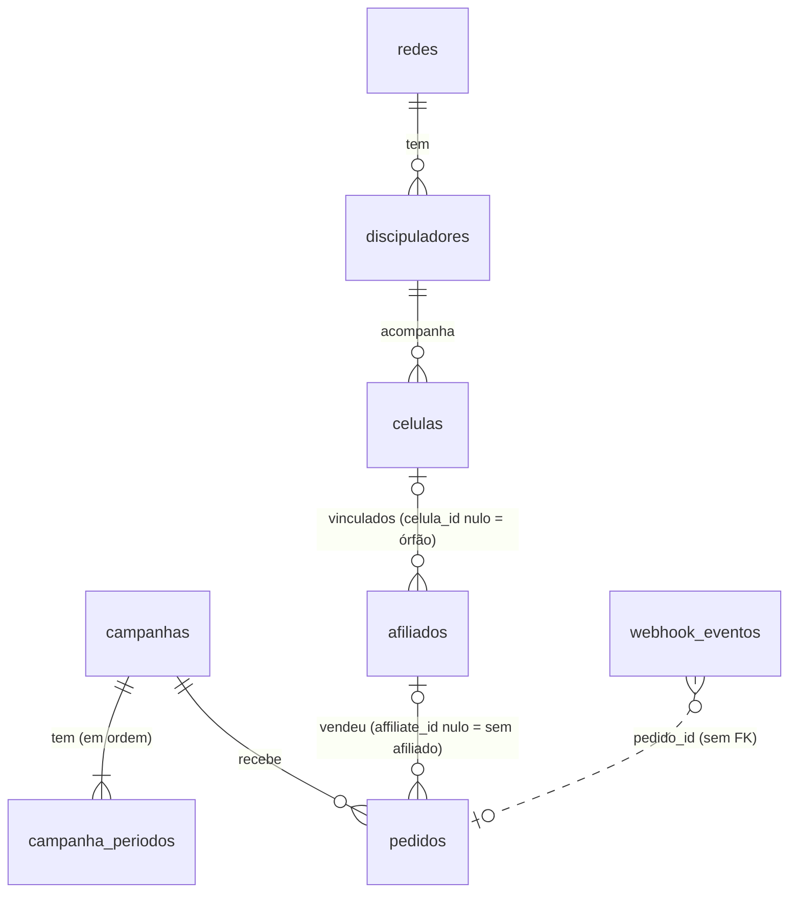

# Modelo de dados (Cloudflare D1)

- Migration: [`migrations/0001_init.sql`](../migrations/0001_init.sql), aplicada depois de `0000_setup.sql` (tabela `_meta`, RIFA-001).
- Tipos e schemas espelho: `src/shared/contracts/dominio.ts`.
- Teste do schema no workerd com o D1 local: `src/worker/test/migrations.test.ts` (tabelas e view criadas, CHECK de enum, FK, gravação de um pedido válido e atribuição pela view).
- Integração com a Rifei, com as decisões D1 a D9: [integracao-rifei.md](integracao-rifei.md).

## 1. Visão geral



- **Hierarquia da igreja**: rede (divisão `jovens` ou `adultos`) → discipulador → célula (com `qtd_pessoas` e os dados do líder).
- **Rifei**: cada pedido chega pelo webhook e vira uma linha em `pedidos`, com o estado atual. Toda entrega também vira uma linha em `webhook_eventos`.
- **Ponte entre os dois lados**: `afiliados` liga o `affiliate_id` da Rifei a uma célula. A célula de uma venda é resolvida na **leitura** (view `vendas_aprovadas`), nunca gravada no pedido (D7).
- **Configuração**: `campanhas` e `campanha_periodos` guardam as regras da campanha (datas, preço, períodos e percentuais, regra de meta, critério do ranking, visão pública). Nada disso fica no código.

## 2. Convenções

- Nomes em português, snake_case. Os ids são `INTEGER PRIMARY KEY`, com duas exceções que vêm da Rifei: `pedidos.id` (texto) e `afiliados.affiliate_id` (inteiro).
- **Dinheiro em centavos** (`INTEGER`), conforme D2, convertido de forma exata a partir do decimal, com fração de centavo arredondada meio para cima ([integracao-rifei.md](integracao-rifei.md#6-valores-d2-e-fuso-d8)). **Percentuais em pontos-base** (3500 = 35%).
- Dinheiro, contadores e ids da Rifei têm `CHECK (typeof(x) = 'integer')`. A afinidade `INTEGER` do SQLite aceitaria `60.5` ou `'abc'` sem reclamar.
- **Instantes em UTC**, texto ISO 8601 com milissegundos e `Z` (`2026-12-01T12:20:31.512Z`). Com um formato único, a ordem alfabética é a cronológica, e o filtro por intervalo usa índice. O padrão das colunas `criado_em` e `atualizado_em` é `strftime('%Y-%m-%dT%H:%M:%fZ', 'now')`.
- **Datas locais** da campanha em `YYYY-MM-DD`, no fuso da campanha (D8).
- Os formatos de data e instante são checados com `date()` e `strftime()` (`CHECK (strftime('%Y-%m-%dT%H:%M:%fZ', x) IS x)`), e não com `GLOB`: o D1 recusa padrões GLOB/LIKE longos ("LIKE or GLOB pattern too complex"). A checagem também recusa datas impossíveis, como 30/02.
- O D1 sempre aplica chaves estrangeiras. Todas as exclusões são `RESTRICT`, e a API responde `409 em_uso`. A exceção é `campanha_periodos`, que cai junto com a campanha (`CASCADE`).
- **D1/LGPD**: nenhuma coluna guarda nome, e-mail, documento, data de nascimento, endereço ou telefone completo do comprador. Os dados do **líder** de célula (nome, e-mail, telefone) são da equipe da igreja e fazem parte do cadastro da hierarquia.

## 3. Tabelas

### `campanhas`

Configuração da campanha. A API v1 trabalha sempre com a campanha **ativa**, e o índice parcial `campanhas_uma_ativa` garante no máximo uma.

| Coluna | Tipo | Regra |
|---|---|---|
| `id` | INTEGER PK | |
| `nome` | TEXT | 1–120 caracteres |
| `slug_rifei` | TEXT UNIQUE | slug da campanha na Rifei: só eventos com esse slug são processados (D5) |
| `ativa` | INTEGER 0/1 | padrão 1 |
| `fuso_horario` | TEXT | IANA; padrão `America/Belem` (D8) |
| `data_inicio` | TEXT | data local, primeiro dia de vendas |
| `preco_bilhete_centavos` | INTEGER > 0 | |
| `meta_unidade` | TEXT | `bilhetes` ou `centavos` |
| `meta_regra` | TEXT | `por_pessoa`, `total_proporcional` ou `fixa_por_celula` ([regras-de-calculo.md](regras-de-calculo.md), R1) |
| `meta_valor` | INTEGER > 0 | na unidade da meta; o significado depende da regra |
| `ranking_criterio` | TEXT | `percentual_meta`, `bilhetes` ou `arrecadacao` |
| `publico_mostra_percentual_meta` | INTEGER 0/1 | padrão 0: o público vê só posições |
| `publico_limite_ranking` | INTEGER 1–100 ou NULL | padrão 3 (top 3); NULL mostra todas as posições |
| `criado_em`, `atualizado_em` | TEXT | instantes UTC |

O fim da campanha não é guardado: é `data_inicio + soma dos dias dos períodos − 1`.

### `campanha_periodos`

Períodos **consecutivos** a partir de `campanhas.data_inicio`, na `ordem` (ex.: 3 "semanas" de 10, 7 e 7 dias). Como cada período tem só a duração, não existe buraco nem sobreposição entre eles.

| Coluna | Tipo | Regra |
|---|---|---|
| `campanha_id` | INTEGER FK → campanhas (CASCADE) | PK (campanha_id, ordem) |
| `ordem` | INTEGER ≥ 1 | 1, 2, 3… |
| `nome` | TEXT | ex.: "Semana 1" |
| `dias` | INTEGER 1–366 | |
| `percentual_bp` | INTEGER 0–10000 | **a soma não precisa dar 10000**: o cálculo normaliza (seção 7.3) |

### `redes`, `discipuladores`, `celulas`

| Tabela | Colunas principais | Regras |
|---|---|---|
| `redes` | `nome`, `divisao`, `responsavel_nome` (pastor ou obreiro da rede, opcional) | `divisao` ∈ {`jovens`, `adultos`}; `nome` único |
| `discipuladores` | `rede_id` → redes, `nome` | `nome` único; índice por `rede_id` |
| `celulas` | `discipulador_id` → discipuladores, `nome`, `qtd_pessoas`, `lider_nome`, `lider_email`, `lider_telefone` | `nome` único; `qtd_pessoas` 1–1000 (é a base da meta); e-mail e telefone opcionais; índice por `discipulador_id` |

Os nomes são únicos com `COLLATE NOCASE`, que só ignora maiúsculas ASCII. A API compara nomes ignorando também maiúsculas acentuadas e os espaços nas pontas. Os nomes servem de chave na importação por CSV.

### `afiliados` (D7)

| Coluna | Tipo | Regra |
|---|---|---|
| `affiliate_id` | INT PK NOT NULL, > 0 | id do afiliado na Rifei. É `INT`, e não `INTEGER`, de propósito: assim não é alias do rowid, e um INSERT com NULL falha em vez de criar um afiliado fantasma |
| `celula_id` | INTEGER FK → celulas, NULL | NULL = **não vinculado** (fila de órfãos) |
| `rotulo` | TEXT NULL | nota da coordenação (ex.: usuário do líder na Rifei) |
| `origem` | TEXT | `webhook` (apareceu numa venda) ou `manual` (pré-cadastro) |
| `criado_em`, `atualizado_em` | TEXT | |
| `vinculado_em` | TEXT NULL | preenchido **se e somente se** `celula_id` não é NULL (CHECK) |

Uma célula pode ter mais de um afiliado, por exemplo se o líder tiver duas contas. As vendas de todos eles somam na célula.

### `pedidos`

Estado **atual** de cada pedido da Rifei. **Só `status = 'approved'` conta como venda.**

Os campos informativos (`status_rifei`, `status_detail_rifei`, `subtotal_centavos`, `metodo_pagamento`, `rifinha`, `criado_em`, `expira_em`) ficam NULL quando a Rifei manda o campo ausente ou com tipo errado: o webhook aceita a venda e registra o aviso em `webhook_eventos.avisos` (RIFA-002b). Os essenciais nunca ficam NULL: `id`, `campanha_id`, `status`, `qtd_bilhetes` e `total_centavos`.

| Coluna | Tipo | Origem no payload |
|---|---|---|
| `id` | TEXT PK NOT NULL (1–128) | `id`. O NOT NULL é explícito porque, no SQLite, uma PRIMARY KEY que não é INTEGER aceita NULL |
| `campanha_id` | INTEGER FK → campanhas | campanha ativa cujo `slug_rifei` = `slug` |
| `affiliate_id` | INTEGER FK → afiliados, NULL | `affiliate_id` (NULL = sem afiliado) |
| `status` | TEXT | `in_process`, `approved` ou `expired` (máquina D4) |
| `status_rifei`, `status_detail_rifei` | TEXT NULL | `status`, `status_detail` do último evento processado |
| `qtd_bilhetes` | INTEGER ≥ 0 | `numbers_count` |
| `numeros` | TEXT (JSON) NULL | `numbers`, usado na reconciliação |
| `subtotal_centavos` | INTEGER ≥ 0 NULL | `subtotal` (D2) |
| `total_centavos` | INTEGER ≥ 0 | `total` (D2): é o arrecadado; essencial, nunca NULL |
| `desconto_promocao_centavos`, `desconto_cupom_centavos` | INTEGER NULL | `promotion_discount`, `coupon_discount` |
| `cupom_id` | INTEGER NULL | `coupon_id` |
| `metodo_pagamento` | TEXT NULL | `payment_method` |
| `rifinha` | INTEGER 0/1 NULL | `is_rifinha` |
| `ddd` | TEXT NULL | derivado de `buyer.phone`; só para o Brasil (CHECK `ddd IS NULL OR pais = '55'`) |
| `pais` | TEXT NULL | código de discagem do país, derivado de `buyer.phone` (`55` = Brasil) |
| `utm_source` … `utm_term` | TEXT NULL | `utm.*` |
| `criado_em` | TEXT (UTC) NULL | `created_at`; NULL se vier ausente ou inválido |
| `expira_em` | TEXT (UTC) NULL | `expires_at` |
| `aprovado_em` | TEXT (UTC) NULL | `approved_at`; obrigatório quando `approved` (CHECK). Se a Rifei mandar null, vale o instante do recebimento |
| `expirado_em` | TEXT (UTC) NULL | `expired_at` |
| `registrado_em`, `atualizado_em` | TEXT (UTC) | nossos: primeira gravação e última alteração |

### `webhook_eventos` (D3)

Uma linha por entrega **autenticada**, inclusive duplicadas e inválidas. Entregas com 401 ou 503 não são gravadas.

| Coluna | Tipo | Regra |
|---|---|---|
| `id` | INTEGER PK | devolvido como `evento_id` |
| `recebido_em` | TEXT (UTC) | |
| `evento`, `pedido_id`, `slug` | TEXT NULL | como vieram; em `erro_validacao`, só se forem texto |
| `resultado` | TEXT | `processado`, `duplicado`, `ignorado_outra_campanha`, `ignorado_transicao` ou `erro_validacao` |
| `status_anterior` | TEXT NULL | estado do pedido antes do evento (NULL se não existia) |
| `status_resultante` | TEXT NULL | preenchido em `processado`, `duplicado` e `ignorado_transicao` |
| `payload_redigido` | TEXT (JSON) NULL | `payloadRifeiRedigidoSchema`; NULL só em `erro_validacao` |
| `erro` | TEXT (JSON) NULL | lista de problemas, agrupados e limitados como os avisos, sem valores; preenchido **se e somente se** `erro_validacao` |
| `avisos` | TEXT (JSON) NULL | lista **não vazia** das diferenças do payload aceito em relação à doc (RIFA-002b): itens `{ caminho, codigo, mensagem, ocorrencias }`, agrupados por caminho sem índice, no máximo 50 mais um item final `itens_omitidos`, sem valores. CHECK: `json_type = 'array'` e pelo menos 1 item. NULL quando não há aviso (nunca `[]`); nunca em `erro_validacao` |

`pedido_id` não tem FK, porque eventos ignorados ou inválidos não geram pedido. Como o payload redigido fica guardado, dá para **reprocessar** eventos depois (por exemplo, os `ignorado_outra_campanha` recebidos antes de a campanha ser configurada).

### View `vendas_aprovadas`

Pedidos `approved` com a hierarquia resolvida por `LEFT JOIN`: afiliado → célula → discipulador → rede. As colunas são `pedido_id`, `campanha_id`, `affiliate_id`, `qtd_bilhetes`, `total_centavos`, `aprovado_em`, `ddd`, `pais`, `celula_id`, `discipulador_id`, `rede_id` e `divisao`.

- `celula_id` NULL = venda **sem célula** (sem afiliado ou afiliado não vinculado). Ela entra no total da campanha, mas não entra em nenhum ranking.
- Vincular um afiliado muda o resultado da view na hora, sem alterar `pedidos` (D7).

## 4. Índices e consultas típicas

| Índice | Serve para |
|---|---|
| `pedidos_por_status_aprovacao (status, aprovado_em)` | ritmo e ranking por janela de tempo: `status = 'approved' AND aprovado_em >= ? AND aprovado_em < ?` (validado com `EXPLAIN QUERY PLAN`, também através da view) |
| `pedidos_por_afiliado_status (affiliate_id, status)` | totais por afiliado (`GET /api/admin/afiliados`), "sem afiliado" (`affiliate_id IS NULL`) e a FK de `afiliados` |
| `pedidos_aprovados_por_afiliado_dia (campanha_id, affiliate_id, date(aprovado_em, '-180 minutes'), aprovado_em, qtd_bilhetes, total_centavos) WHERE status = 'approved'` (migração 0003) | painel, rankings, ranking público e bumbo (`src/worker/db/painel.ts`): vendas por afiliado e dia local de UTC−3 já na ordem do `GROUP BY`, sem a view, com 1 linha lida no D1 por pedido (pela view eram ~6). A consulta precisa usar a mesma expressão do dia, literal (`db/painel.test.ts` confere o plano) |
| `afiliados_por_celula`, `celulas_por_discipulador`, `discipuladores_por_rede` | subir e descer a hierarquia, e as FKs |
| `webhook_eventos_por_pedido`, `webhook_eventos_por_resultado (resultado, recebido_em)` | auditoria de um pedido; listar erros e ignorados recentes |
| `campanhas_uma_ativa` (parcial, único) | garantir uma única campanha ativa |

Exemplo, ranking de células da campanha `?1` no período, com `[início, fim)` já convertido para UTC (`?2`, `?3`):

```sql
SELECT celula_id, count(*) AS pedidos, sum(qtd_bilhetes) AS bilhetes, sum(total_centavos) AS total_centavos
FROM vendas_aprovadas
WHERE campanha_id = ?1 AND aprovado_em >= ?2 AND aprovado_em < ?3 AND celula_id IS NOT NULL
GROUP BY celula_id;
```

## 5. Ciclo do pedido (D3, D4)

| Estado atual \ evento | `new_order` | `paid_order` | `expired_order` |
|---|---|---|---|
| (não existe) | processado → `in_process` | processado → `approved` | processado → `expired` |
| `in_process` | duplicado | processado → `approved` | processado → `expired` |
| `expired` | ignorado_transicao | processado → `approved` | duplicado |
| `approved` | ignorado_transicao | duplicado | ignorado_transicao |

- Pedido novo: recebe os dados do evento. Pedido existente: o `status` segue a máquina de estados, e os campos informativos (`affiliate_id`, `criado_em`, `expirado_em`, `utm_*`, cupom e descontos, `subtotal_centavos`, `status_rifei`, `status_detail_rifei`, `metodo_pagamento`) só são sobrescritos por valor **não nulo** (`COALESCE`). Um null de tolerância nunca apaga valor bom. `registrado_em` não muda.
- Afiliado tardio: pedido sem afiliado recebe o `affiliate_id` válido de **qualquer** evento dele, inclusive `duplicado` e `ignorado_transicao`.
- A gravação é idempotente: reentregar não duplica nada. Para continuar correta com entregas simultâneas, a transição usa UPSERT condicional (`ON CONFLICT (id) DO UPDATE ... WHERE pedidos.status IN (...)`), dentro de um `db.batch` junto com o afiliado e o evento.
- Fonte executável: `decidirTransicaoPedido` em `dominio.ts`.

## 6. Atribuição (D7)

1. Um `affiliate_id` desconhecido no webhook cria o afiliado com `celula_id = NULL` e `origem = 'webhook'`. É a fila de órfãos, listada em `GET /api/admin/afiliados?vinculado=false`.
2. A coordenação vincula com `PUT /api/admin/afiliados/:affiliateId { "celula_id": 7 }`, ou pré-cadastra o afiliado antes da primeira venda.
3. As vendas passam para a célula imediatamente, porque a view resolve a célula na leitura.
4. Venda sem `affiliate_id` fica em "sem afiliado".

## 7. Cálculos de metas, ritmo, ranking e bumbo

As regras de cálculo (metas e soma por nível, curva com normalização, meta do dia, situação, projeção, rankings, visão pública e bumbo) estão em [regras-de-calculo.md](regras-de-calculo.md), com fontes, exemplos e as suposições para o PO; o código é `src/shared/contracts/calculos.ts`. Nada disso é guardado no banco: as rotas leem a configuração, as células e as vendas aprovadas e calculam na hora. Aqui ficam só as convenções do modelo de dados que os cálculos usam.

### 7.1 Tempo

- `data_inicio` e os `dias` de `campanha_periodos` são do calendário local, sem fuso. Os períodos são consecutivos a partir de `data_inicio`, na `ordem`, e o último dia de vendas é `data_inicio` + soma dos dias − 1 (`calendario.ts`).
- `aprovado_em` é um instante UTC. O dia local `D` é `[D 00:00, D+1 00:00)` no fuso da campanha, convertido para UTC: em `America/Belem` (UTC−3 fixo), `[D 03:00Z, D+1 03:00Z)`, e o dia de uma venda é `date(aprovado_em, '-3 hours')`.

### 7.2 Entradas

- Meta: `meta_unidade`, `meta_regra` e `meta_valor` da campanha e `qtd_pessoas` de cada célula.
- Realizado: `qtd_bilhetes` (unidade `bilhetes`) ou `total_centavos` (unidade `centavos`) da view `vendas_aprovadas`, que só tem pedidos `approved`; `celula_id` NULL é venda sem célula.

### 7.3 Percentuais dos períodos

- `percentual_bp` guarda o valor configurado, que nunca é alterado: 3500, 2500 e 4500 continuam somando 10500. O cálculo normaliza na leitura, e `GET /api/admin/campanha` devolve `soma_percentuais_bp` para a interface avisar quando a soma é diferente de 10000. Pelo menos um percentual precisa ser maior que zero.

## 8. O que não é guardado (D1)

- Do comprador: nome, e-mail, documento (CPF), data de nascimento, endereço, telefone completo, `observation`, `fbp` e `fbc`. Ficam só `ddd` e `pais`.
- O payload bruto do webhook nunca é gravado, só o redigido.
- O CSV da reconciliação, que traz dados pessoais, é processado em memória e descartado.
